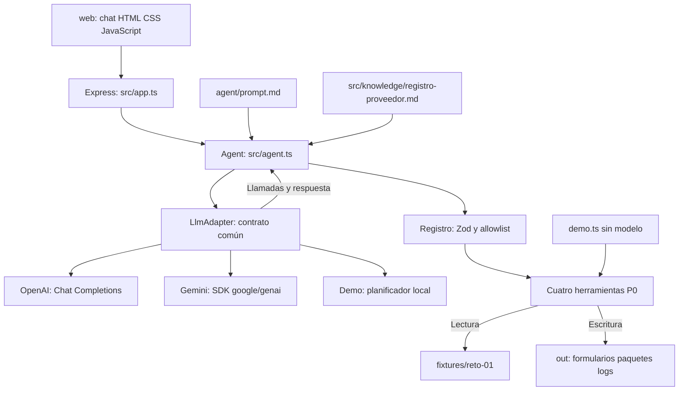

# SOLUCIÓN · Reto Técnico 01

Auditoría final del 2026-11-04. Evidencia: PRD, implementación, pruebas
reproducidas y datos reportados por la autora. Las observaciones sobre servicios
externos no equivalen a conversaciones exitosas.

## 1. PROBLEMA

La analista administrativa repite transcripción de datos y búsqueda de soportes
para registros como proveedor. Esto introduce retrabajo, errores y dependencia
del conocimiento de una persona. Se busca leer solicitudes, completar campos
desde una fuente trazable, explicitar faltantes y preparar formulario, soportes
y borrador para revisión y firma humana. La firma y el envío real no corresponden
al agente.

El alcance entregado cubre Excel P0 y preparación local. PDF P1 y envío simulado
P1 siguen pendientes. La demo sin API permite revisar el flujo, pero no sustituye
la validación del agente con un proveedor real requerida por el reto.

## 2. ARQUITECTURA



src/server.ts carga entorno y construye el adaptador, agente y Express. Frontend
y API comparten proceso, puerto y origen. El backend utiliza TypeScript estricto,
Node 20+, Express, Zod y archivos locales.

La separación del PRD es explícita: **comportamiento** en agent/prompt.md,
**conocimiento** en src/knowledge/ y **ejecución** en src/tools/. El servidor no
contiene reglas tributarias. Ambos Markdown se leen al iniciar; no incluyen
valores del maestro. Los valores empresariales proceden de las herramientas.

src/llm/adapter.ts define enviar(mensajes, herramientas, opciones). OpenAI usa
fetch y Gemini @google/genai; el bucle no interpreta protocolos de esos SDK.
Transporta continuación opaca cuando el adaptador la necesita. El registro
convierte los tipos Zod usados por P0 a declaraciones JSON y rechaza tipos no
soportados, evitando una segunda definición manual de campos.

No hay base de datos ni autenticación. Las sesiones viven en memoria y los
artefactos en out/. No hay endpoint de descarga ni publicación HTTP de out/;
la inspección de Excel desde una demostración exclusivamente remota es limitada.

## 3. CICLO DEL AGENTE

En modo LLM real, POST /api/chat valida message y sessionId, crea o recupera una
sesión UUID y agrega el mensaje. El agente envía instrucciones, conocimiento,
contexto de revisión, historial y declaraciones al adaptador. Este devuelve
llamadas o JSON final con reply y needsConfirmation. El backend correlaciona
llamadas por ID, valida sus argumentos mediante Zod y ejecuta únicamente las
herramientas permitidas. Agrega resultados al historial del modelo y repite hasta
terminar o alcanzar un límite.

Las cuatro herramientas tienen description, args con descripciones Zod y execute,
que devuelve string JSON con ok/data o ok:false/error sin propagar excepciones.
El registro audita los rechazos previos. La generación recalcula y contrasta el
mapeo con el maestro antes de aceptar valores; etiquetas y celdas provienen de
la plantilla. No se ofrece shell ni una herramienta de envío externo.

El historial visible conserva usuario, respuesta final y cada herramienta con
argumentos/resultados. El frontend muestra las llamadas al concluir el turno,
indica procesamiento y destaca revisión; no hay streaming. GET /api/sessions/:id
recupera ese historial sin prompts privados. sessionStorage guarda el UUID en el
navegador; Nueva conversación no elimina la sesión en servidor.

Los límites predeterminados son 25 llamadas al adaptador por turno, reserva de
100000 tokens por sesión y 1000000 por instancia, salida de 4096 por petición
real y timeout de 30000 ms, configurables por entorno. Hay máximo de 100 sesiones
y umbral de 500 eventos comprobado antes del turno; un turno puede añadir varios
eventos. Se aceptan hasta ocho llamadas por respuesta y se serializa el trabajo
en toda la instancia para proteger out/<caso>. La concurrencia recibe 409.

La reserva utiliza bytes UTF-8, margen de protocolo y salida máxima; no es consumo
facturado. Con continuación se cuenta la representación mayor, sin duplicar la
llamada. Las reservas fallidas no se reintegran. Se registra el total de tokens
de respuestas válidas, sin separar entrada/salida. Todo se reinicia con el proceso.
Los límites producen una respuesta parcial. Los errores de herramientas vuelven
al modelo como resultados; errores de proveedor, timeout o formato llegan al
chat sin trazas ni cuerpos remotos completos. La sesión permite reintentar
dentro del presupuesto.

Las herramientas registran out/log.jsonl y, para casos válidos,
out/<caso>/log.jsonl con ts, herramienta, ok, resumen y sessionId. No vuelcan
valores bancarios. El registro audita también argumentos/JSON inválidos y
herramientas rechazadas. Un fallo de auditoría devuelve error y puede dejar
artefactos parciales: el paquete no tiene transacción atómica.

El backend exige pregunta de revisión tras preparar un paquete o mapear con
advertencias. Solo reconoce una afirmación explícita en el mensaje inmediatamente
siguiente; otra intervención invalida la oportunidad. Revisar no modifica el
maestro ni resuelve automáticamente un identificador extranjero. No existe
proveedor_simular_envio: aun tras confirmar, envía no crea ENVIO-SIMULADO.md.
La revisión entre turnos está probada; no se declara completo el criterio de
envío simulado del PRD.

En **demo**, un adaptador separado reconoce un caso y emite las cuatro llamadas
en orden. Toma campos/mapeo de los resultados y el registro común ejecuta las P0.
Si lectura/mapeo fallan, informa; si generación falla por PDF/portal, continúa
al paquete. El resumen procede de herramientas, sin resultados empresariales
precargados. No es un LLM ni interpreta preguntas generales. No consume/reserva
tokens remotos; mantiene iteraciones, sesiones, historial, serialización y revisión.

## 4. ELECCIÓN DEL MODELO

LLM_PROVIDER admite openai, gemini y demo sin cambiar el ciclo. Ausente o vacío
conserva openai por compatibilidad; no hay modelo predeterminado en código.
Solo se requiere la clave del proveedor activo. Se lee exclusivamente en backend,
fuera de frontend, prompts, logs y respuestas. Existe redacción HTTP adicional
de claves conocidas.

| Proveedor | Implementación | Configuración local inspeccionada | Validación |
|---|---|---|---|
| OpenAI | fetch a /v1/chat/completions, herramientas y JSON final | OPENAI_MODEL=gpt-4o-mini | Contrato con fetch controlado; conversación real no completada |
| Gemini de Google AI Studio | @google/genai, generateContent, declaraciones/respuestas y firmas | GEMINI_MODEL=gemini-3.8-flash | SDK con HTTP controlado; conversación real no completada |
| demo | Planificador local determinista | LLM_PROVIDER=demo; model:null | Cuatro casos y archivos reales sin API |

Los identificadores reflejan el entorno local, no valores por defecto ni la
configuración verificada de Render. La autora reportó que **OpenAI devolvió
credit_balance_exhausted y Gemini devolvió 503 UNAVAILABLE**. Se registra su
reporte como antecedente; no se encontró en el repositorio evidencia sanitizada
de esas ejecuciones para reproducirla. No se cambiaron claves o proveedores para
resolverlo. Integración implementada no significa validación exitosa con servicios reales.

OpenAI necesita herramientas, Chat Completions, JSON y max_completion_tokens.
La ficha oficial consultada marca GPT-4o mini como deprecado: debe confirmarse
su disponibilidad antes de otra prueba, sin atribuir a esta auditoría una migración.
Gemini consulta models.get y generateContent; luego fuerza una llamada de
verificar_capacidad sin ejecutarla. Cachea el éxito por instancia, conserva partes
y firmas originales, admite IDs opcionales y no activa AFC, continuaciones ni
reintentos automáticos. Su sonda limita salida a 1024 tokens y suma el consumo
válido al turno; mientras está pendiente se reserva 4096 adicionales. Un fallo
de disponibilidad, cuota, formato o truncamiento no se presenta como verificación.

**Costo estimado por caso, no medido.** Se usa facturación estándar de texto,
sin Batch, caché, grounding, herramientas alojadas, impuestos ni infraestructura.
Las P0 locales no tienen tarifa remota propia. I suma la entrada de todas las
peticiones, incluidos historial, esquemas y prompt. O suma la salida facturable,
incluidos pensamientos cuando corresponda. El primer caso Gemini incluye su sonda.

```text
Costo USD = (I × precio_entrada_por_millón + O × precio_salida_por_millón) / 1 000 000
```

Escenario de planificación: aproximadamente cinco peticiones principales (cuatro
pasos y cierre), con I entre 10000–30000 y O entre 2000–6000 para el caso completo.
Son supuestos de sensibilidad, no consumo observado ni cota máxima. Repetición de
historial, razonamiento y errores pueden cambiarlos; el código permite más
iteraciones. No hay una conversación remota exitosa para calibrarlos.

| Modelo de referencia | Entrada USD/1M | Salida USD/1M | Costo hipotético del escenario |
|---|---:|---:|---:|
| gpt-4o-mini | 0.15 | 0.60 | USD 0.0027–0.0081 |
| gemini-3.8-flash, Standard introductorio | 0.75 | 3.75 | USD 0.015–0.045 |

Precios consultados el 2026-11-04 en la [ficha oficial GPT-4o mini](https://developers.openai.com/api/docs/models/gpt-4o-mini)
y [Gemini Developer API Pricing](https://ai.google.dev/gemini-api/docs/pricing#gemini-3.8-flash).
Google indica fin de esa tarifa introductoria el 2026-12-31; desde 2027-01-01
publica USD 1.50/1M de entrada y USD 7.50/1M de salida. Revisar tarifas y acceso
al ejecutar. No se asume cuota gratuita. El contador agregado no da una factura
exacta por entrada/salida: falta medir ese desglose. Demo cuesta cero en API,
sin implicar que equipo o alojamiento sean gratuitos.

## 5. DISEÑO DE PORTALES WEB

Solo se preparan valores copiables. Como diseño futuro, navegador controlado o
RPA podría localizar campos con selectores estables, cargar datos validados y
preparar adjuntos. Debe detectar cambios de layout, validaciones y páginas
inesperadas; ante incertidumbre, detenerse y mostrar el campo afectado.

El humano ingresa credenciales y resuelve MFA/CAPTCHA; el agente no los evade ni
los almacena en chat. Si se necesitara sesión técnica, sus secretos vivirían en
un gestor seguro o memoria efímera, fuera de código, prompt y logs; las capturas
y auditoría deben omitirlos. Esto no está implementado.

Antes de cualquier envío se presentaría destino, valores, adjuntos y advertencias
para confirmación explícita. El clic final Enviar y el ingreso de credenciales
seguirían siendo humanos, como exige PRD 7.4. Se revisaría la respuesta del portal
para identificar rechazos y duplicados. Firma y envío real permanecen fuera del alcance.

## 6. DECISIONES Y TRADE-OFFS

| Decisión comprobable | Alternativa no adoptada | Justificación y consecuencia |
|---|---|---|
| TypeScript estricto y ESM | JavaScript sin comprobación estática | Contratos claros y detección en compilación; exige build y tipos |
| Zod en argumentos/entradas | Confiar en JSON del modelo | Rechazo previo y contratos reutilizados; conversión JSON limitada a tipos usados |
| Archivos y sesiones en memoria | Base de datos | Menos infraestructura, suficiente para el reto; sin durabilidad ni coordinación multiinstancia |
| HTML/CSS/JS servido por Express | Framework y frontend separado | Un proceso y origen; interfaz manual y sin streaming |
| LlmAdapter independiente | SDK dentro del bucle | Sesiones y herramientas comunes; exige traducción y pruebas de protocolos |
| Glosario determinista y contraste al generar | Completar valores con el modelo | Fuente trazable y rechazo de alteraciones; sin fuente el dato queda faltante |
| Demo separado | Respuestas remotas ficticias o resultados fijos | Archivos reales sin servicios; no demuestra conversación con LLM |
| Serialización por instancia | Escrituras concurrentes en out/<caso> | Evita colisiones internas; limita concurrencia y no protege frente a otros procesos |

Son decisiones observables y sus consecuencias, no una historia inventada de
recomendaciones propuestas y rechazadas por asistentes. Dependencias: Express
para HTTP, Zod para validación, ExcelJS para XLSX, dotenv para entorno local,
@google/genai para Gemini, TypeScript y tsx para desarrollo. Esta auditoría no
instala dependencias ni cambia la implementación.

## 7. SUPUESTOS

- Los fixtures ficticios representan la variabilidad evaluada y no se modifican.
  Los JSON sustituyen las plantillas originales; los soportes son placeholders .txt.
- El maestro es la fuente vigente y un futuro dueño del dato mantendría su calidad.
  Las equivalencias se resuelven por glosario normalizado, sin inventar valores.
- CO usa NIT; EC/PE/PA RUC y HN RTN. Solo existe NIT colombiano: se conserva con
  requiere_confirmacion y nota identificador extranjero.
- Solo se llenan datos bancarios pedidos en plantilla; no van al borrador.
  Los resultados técnicos de las herramientas sí pueden contenerlos.
- Vigencia inclusiva: vence si vigencia_hasta es anterior a la referencia. Sin
  fecha registrada no se considera vencido. Ausentes/vencidos bloquean; campos
  faltantes por sí solos no. Formulario no soportado deja el paquete incompleto.
- REFERENCE_DATE controla el chat; vacío usa UTC actual. demo.ts lee el entorno
  del proceso y usa 2026-11-03 por defecto, sin cargar .env. Los tests HTTP fijan
  esa referencia. Timestamps de logs y vigencias no se confunden.
- Se ejecuta desde la raíz y se puede escribir en out/. No se garantiza conservar
  sesiones o salidas entre reinicios.
- La autora declara Render con Build npm ci && npm run build y Start npm start.
  No hay configuración versionada ni panel inspeccionado; plan, variables,
  versión de Node y persistencia remotos deben confirmarse.
- La evaluación distingue demo, respuestas controladas y servicios reales. No
  se presupone cuota de API. No se midió tiempo de instalación/arranque.

## 8. COBERTURA FUNCIONAL

| Requisito | Estado | Evidencia | Limitación / falta para producción |
|---|---|---|---|
| HU-1 Leer solicitud | Hecho | leer_solicitud y pruebas HTTP de cuatro casos | Correo normalizado; sin integración de correo ni extracción de adjuntos reales |
| HU-2 Mapear campos | Hecho | mapear_campos; comparación con maestro y rutas en tests/demo.test.mjs | Glosario determinista; sin corrección persistente ni evaluación semántica general |
| HU-3 Formato del cliente | Parcial | Excel P0 con ExcelJS; XLSX reabiertos y celdas verificadas | PDF P1 no implementado; no hay AcroForm ni PDF generado |
| Portal P2 | Parcial | valores-portal.md y formato no soportado | Automatización real no implementada; diseño en apartado 5 |
| HU-4 Paquete para firma | Parcial | Excel/soportes, checklist, borrador y bloqueos probados | Envío simulado P1 pendiente; sin descarga ni publicación atómica |
| Confirmación humana | Parcial en el flujo completo | Pregunta de revisión y reconocimiento solo en turno siguiente, tests de agente/demo | No habilita firma/envío ni valida una futura acción externa |
| HU-5 Errores | Parcial | Negativos Zod, inexistente, traversal, JSON, soporte ausente, timeout y recuperación | Proveedor controlado; no cubre todos los fallos remotos o plantillas de producción |
| Integración LLM | Parcial | OpenAI/Gemini y protocolos con respuestas controladas | Sin validación exitosa de servicios reales; errores reportados en apartado 4 |
| Demo independiente | Hecho | demo.ts y DemoAdapter, cuatro casos y archivos reales sin API | No es un LLM ni interpreta conversación general |
| UI y API | Hecho en código y HTTP | Health, chat, sesiones, recursos y sintaxis JS | Revisión visual pendiente; sin autenticación, streaming ni descarga |
| Logs y límites | Hecho con alcance local | Ambos JSONL, presupuestos y concurrencia probados | Sin retención, cuotas compartidas ni aislamiento multiinstancia |
| Módulo reutilizable bonus | No hecho | No existe modulo/ | Empaquetado y comprobación de piezas compartidas pendientes |
| Despliegue evaluable | Parcial | URL/comandos proporcionados por la autora | Disponibilidad y health de Render no verificados desde este entorno |

Auditoría del 2026-11-04: tsc --noEmit y compilación correctos, **17 aprobadas y
0 fallidas** con node --test tests/*.test.mjs: 7 de agente, 5 de Gemini y 5 de demo.
No se informa cobertura porcentual. La suite demo procesó los cuatro casos por
HTTP; la Gemini usa el SDK oficial contra servidor local controlado, no Google.

Se ejecutó demo.ts compilado con referencia 2026-11-03 desde una copia temporal,
sin limpiar out/ del proyecto ni afectar al servidor activo. Pasaron Excel,
trazabilidad, paquetes, vigencias, faltantes, logs, datos bancarios no pedidos,
inexistente, traversal, mapeo alterado, soporte ausente y fecha inválida. Se
comprueba también que no persista en el paquete un soporte eliminado. JS pasó
node --check. No se completó revisión visual ni se repitió el ENOMEM histórico
de tsx en esta auditoría.

| Caso | Llenos | Faltantes | Requiere confirmación | Resultado con fecha 2026-11-03 |
|---|---:|---:|---:|---|
| Colombia: co-industrias-delta | 17 | 0 | 0 | Excel; listo_para_firma:false por Cámara vencida |
| Ecuador: ec-corp-andina | 13 | 1 | 1 | PDF pendiente; Cámara vencida y certificado tributario ausente |
| Honduras: hn-agroexport-sula | 9 | 1 | 1 | Excel; Cámara y parafiscales vencidos |
| Panamá: pa-logistica-istmo | 8 | 0 | 1 | Valores copiables; Cámara vencida y formulario no soportado |

**Ningún paquete está listo para firma por soportes vencidos o ausentes: es el
resultado esperado de negocio, no un fallo del programa.** Cámara vence el
2026-09-30 y parafiscales el 2026-08-31. Faltan número de contribuyente especial
en Ecuador y referencias comerciales en Honduras; no bloquean por sí solos.
PDF/portal agregan la limitación de formulario no disponible. No se inventan
soportes ni se declara vigente un documento vencido para obtener listo:true.

Enlace informado: [Render: reto-01-periferia-7phu](https://reto-01-periferia-7phu.onrender.com/).
Se intentó GET a / y /api/health sin acceso desde las herramientas del entorno.
No se concluye que el servicio esté caído ni se afirma una prueba remota exitosa.
La autora debe comprobarlo durante la defensa. El PRD anuncia 70/100, pero su
sección 10 no presenta rúbrica detallada: no se calcula ni garantiza puntuación.

## 9. USO DE INTELIGENCIA ARTIFICIAL

Se declaran **OpenAI Codex y ChatGPT** como asistentes utilizados durante el
desarrollo, conforme a la declaración solicitada por la autora.

OpenAI Codex se utilizó para inspección del PRD/fixtures, estructura, herramientas,
adaptadores, ciclo, demo, frontend, pruebas y documentación. La conversación de
trabajo y los archivos permiten rastrear esas tareas. Se verificaron resultados
mediante TypeScript, ejecución real de herramientas, reapertura de Excel, HTTP y
casos negativos; una respuesta conversacional no se aceptó como evidencia de
archivo generado o conexión remota exitosa.

Para ChatGPT no hay un registro separado en el repositorio que permita atribuir
responsabilidades exactas sin suponerlas. La autora debe confirmar qué tareas,
prompts o revisiones realizó con ese asistente y qué revisó personalmente. No se
le atribuye una implementación o prueba concreta no registrada. Tampoco se
inventan recomendaciones descartadas: el apartado 6 describe el código final,
no propuestas históricas de una IA. Si hubo sugerencias rechazadas, la autora
debe aportar ejemplos y razones verificables.

La auditoría consultó precios y Render en fuentes oficiales; no creó funcionalidades,
cambió claves/proveedores ni pidió completar valores empresariales. La autora
debe explicar el código, supuestos y límites en la defensa, como exige el PRD.

## 10. RIESGOS Y MITIGACIONES

| Riesgo | Mitigación implementada | Recomendación futura, no implementada |
|---|---|---|
| Alucinaciones y prompt injection | Prompt de fuente única/datos no confiables, Zod, contraste del mapeo y resumen demo desde herramientas | Evaluaciones adversarias y verificador semántico de prosa; revisión humana |
| Datos confidenciales | Claves en backend, redacción HTTP conocida, sin datos bancarios en logs/borradores; textContent en UI | Autenticación, autorización por sesión, cifrado y retención; tool results sí contienen datos empresariales |
| Vencimientos/ausencias | Comparación por fecha y checklist que bloquea firma | Dueño del dato, actualización y alertas; separar fecha de prueba y operativa |
| Seguridad API/filesystem | Allowlist, Zod, límites de entrada, rechazo de traversal/enlaces | Rate limiting, control de acceso, aislamiento por sesión y protección frente a carreras externas |
| Disponibilidad/cambios LLM | Timeout, errores sanitizados, sesión conservada y demo independiente | Monitoreo y compatibilidad real; contingencia autorizada sin confundir demo con LLM |
| Costo | Iteraciones, salida y reservas por sesión/instancia | Desglose de tokens, alertas y cuotas persistentes entre reinicios/instancias |
| Persistencia temporal Render | Limitación documentada; sin promesa de retención | Almacenamiento de objetos/base de datos o disco correctamente montado y respaldos |
| Escalabilidad/colisiones | Serialización en la instancia | Cola, exclusión distribuida, directorios por ejecución y sesiones persistentes |
| Errores de formularios | Excel exacto, faltantes explícitos, contraste con maestro y pruebas de celdas | Plantillas reales, publicación atómica, accesibilidad y QA visual; PDF pendiente |
| Portales | Solo valores copiables, sin credenciales ni envío automático | Detección de cambios, MFA/CAPTCHA humanos, revisión de destino y clic final humano |

La prosa LLM no tiene verificador independiente. UUID no equivale a autorización;
una persona con el identificador puede consultar la sesión. Los presupuestos
reiniciables no son una cuota global de cuenta. Un fallo de logs/paquete puede
dejar archivos parciales. Estas limitaciones no se presentan como capacidades completas.

Render utiliza filesystem efímero por defecto: sin disco persistente, los cambios
locales se pierden en reinicios/redeploys; las sesiones en memoria se pierden en
cualquier caso. No se comprobó plan, disco ni variables del servicio reportado.
Fuente: [Render Persistent Disks](https://render.com/docs/disks). El servidor sí
implementa 0.0.0.0 y PORT, compatibles con [Render Web Services](https://render.com/docs/web-services).
No se desplegó ni se hizo commit/push en la auditoría. La validación pública y
los datos de autoría pendientes deben revisarse antes de la entrega definitiva.
